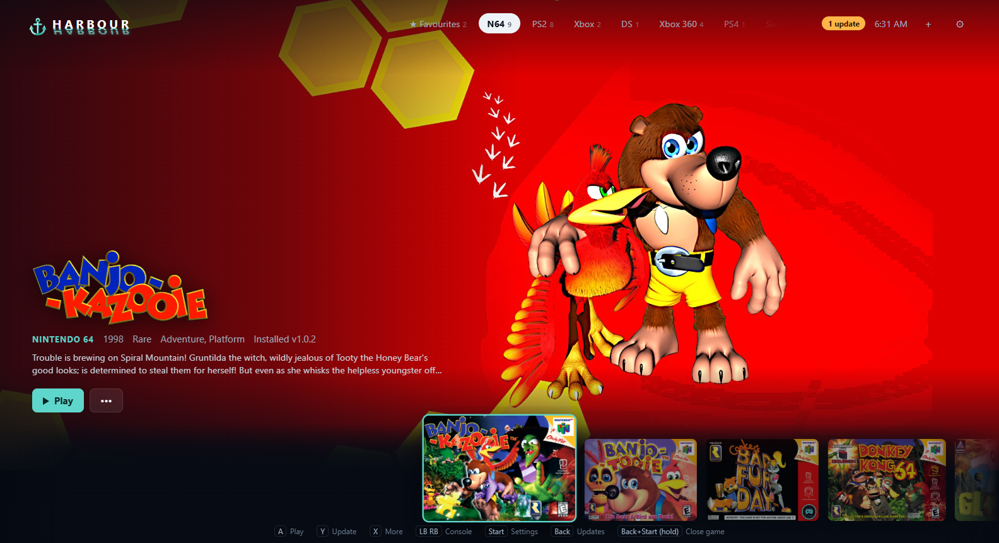
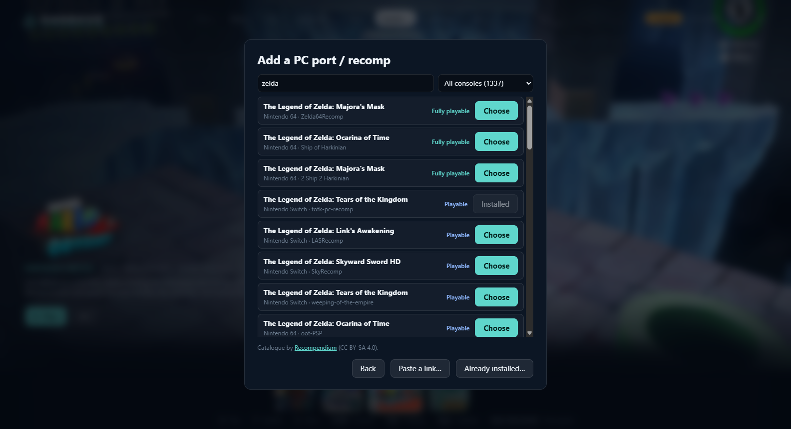
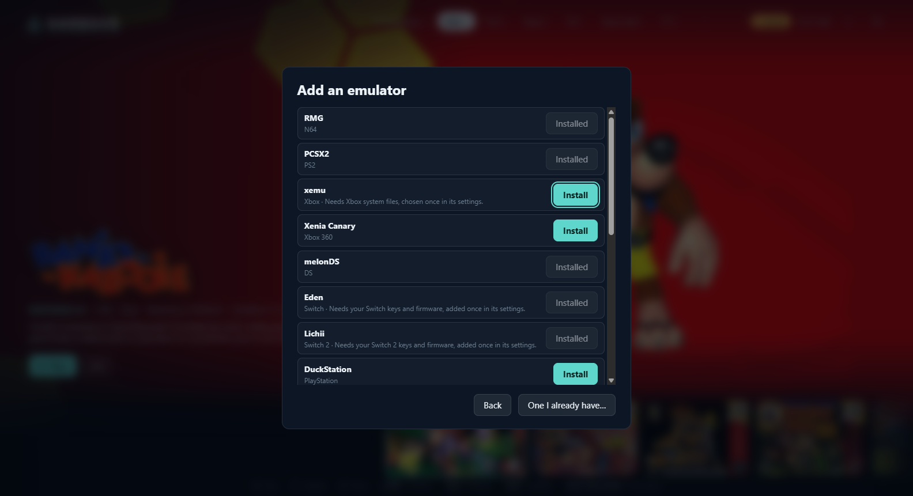

# Harbour

**Your PC ports, recomps and emulators on one shelf per console: installed, kept up to date and set up for you.**

Ship of Harkinian sits on the N64 shelf next to the N64 games you play in an emulator. Harbour installs both kinds
in a click, updates both in a click, sets the emulators up so games open fullscreen and sharp, and tells you when a
game you play in an emulator has a PC port. A big-picture, controller-first screen with gameplay clips for every game
ties it together.

## What makes it different

- **Ports and emulators, together.** Recomps and ports go on their original console's shelf, next to that console's
  emulator games. If you have a game both ways, the port is the one shown.
- **"Install PC port" where it matters.** When a game you play in an emulator has a PC port, a button next to Play
  says so, along with how well the best port runs (Fully playable, Playable, Experimental).
- **Over 1,300 ports to browse.** Search the catalogue, pick one and choose your game file. Harbour downloads it,
  checks it, installs it and shelves it. You can also paste any GitHub link, or add a port you already have.
- **Emulators that just work.** Add a games folder or press Play, and Harbour installs the right emulator from its
  official releases. Games open fullscreen, drawn at a resolution that fits your screen (on a 1440p screen: PS2,
  GameCube and Xbox at 3×, PS1 at 6×, DS at 8×), with a standard pad layout where none is set. Change anything in the
  emulator and your choice stays.
- **Updates for everything, one queue.** Ports, emulators and Harbour itself are updated in one click ("Update all"
  does the lot). Every download is checked against its published checksum and its uploader (an update from a
  different account is refused), backed up, and keeps your settings. Ports that update themselves say "update in
  app", and Harbour notices when you've done it.

## Everything else

- **One big picture.** The game's background art fades into a 45-second HD gameplay clip. After a while the
  interface fades and the clip plays on like a screensaver. Clips can be switched off.
- **Artwork and clips by themselves**, without accounts: covers, logos and backgrounds from the LaunchBox games
  database, GameTDB and libretro thumbnails; clips cut from no-commentary longplays. 🎲 swaps the background or the
  clip for another.
- **Undock** takes a game off the shelves and keeps everything; Settings redocks it. For ports Harbour installed,
  **Undock and delete** removes only what the install put there: your saves and mods stay in its folder.
- **Light.** Nothing moves unless you're using it; in the background or while a game runs, Harbour freezes.
- **Controller first**, mouse and keyboard too. A Steam Controller works through Steam.
- **No AI at runtime.** Everything is plain rules and downloads.

Harbour includes no games, ROMs, keys or game data: you bring your own copies, the same as for any emulator or
port.

## Getting started

Harbour runs on Windows 10 and 11.

**Download** the latest `Harbour-<version>-win64.zip` from [Releases](https://github.com/goodthanksdev/harbour/releases),
unzip it anywhere and run `Harbour.exe`. Windows may say "Windows protected your PC" the first time, because Harbour
isn't code-signed: choose **More info → Run anyway**. Harbour keeps itself up to date after that. To start it from
Steam, add `Harbour.exe` as a non-Steam game (`Harbour.ico` is next to it).

**From source** (needs [Node.js](https://nodejs.org/)): `git clone`, then `npm install` and `npm start`.
`npm run release:build` makes the release zip in `dist\`.

Then, in Harbour:

1. **Pick your games folder** (Harbour asks the first time; later: Settings → Emulators & game folders → Manage).
   It finds the console folders inside (N64, PS2, Switch…), and emulators for those consoles install by themselves.
2. **＋ → PC port / recomp**: pick one from the catalogue (or paste its GitHub page) and choose your game file, or
   "Already installed…" for one you have.
3. Artwork and clips arrive by themselves.

Everything Harbour keeps (settings, artwork, clips, logs) lives in `data\` next to it; emulators and ports it installs
go in `Emulators\` and `Ports\`. Updates to Harbour never touch them.

## Controls

| Pad | Keyboard | |
|---|---|---|
| A | Enter or Space | Play |
| B | Esc | Back / close |
| X | X | More (favourite, rename, cover art, clip, PC port, undock…) |
| Y | U | Update this game |
| LB / RB | Q / E or ↑ / ↓ | Previous / next console |
| LT / RT | Page Up / Page Down | Jump along the shelf |
| Start | F1 | Settings |
| Back | | Updates |
| Back + Start (hold) | | Close the running game |
| | F11 | Fullscreen |

## Making it yours

- **UI sounds:** drop `move`, `tab`, `select`, `open`, `back`, `launch` or `error` (.wav, .ogg or .mp3) into
  `ui\sounds\` (in a release: `resources\app\ui\sounds\`) and it replaces that built-in sound.
- **Logo and icons** are drawn by `scripts/build-harbour-brand.cjs`; `npm run brand:build` rebuilds them.

## Built on

- [PyroCade](https://github.com/Pyrodrifter/PyroCade) by Pyrodrifter: Harbour started from it, and its library
  engine is still based on PyroCade's code.
- [Recompendium](https://recompendium.com/): the port catalogue (CC BY-SA 4.0).
- The [LaunchBox Games Database](https://gamesdb.launchbox-app.com/), [GameTDB](https://www.gametdb.com/) and
  [libretro thumbnails](https://thumbnails.libretro.com/): game details and artwork.
- [Electron](https://www.electronjs.org/), [yt-dlp](https://github.com/yt-dlp/yt-dlp) and
  [FFmpeg](https://ffmpeg.org/).
- And every emulator and port it installs, each from its own project's official releases under its own licence.

Details in [THIRD_PARTY_NOTICES.md](THIRD_PARTY_NOTICES.md).

## License

[MIT](LICENSE)
