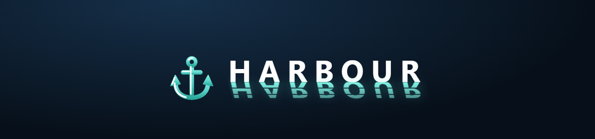

# Harbour



Every game, one harbour. A lightweight, controller-friendly launcher for **PC recomps and ports and emulators**,
side by side on their real console's shelf, kept up to date for you.

## What it does

- **One big picture.** The selected game's background art fades into a 45-second HD gameplay clip. Console tabs
  along the top in release order, covers on a shelf along the bottom. After a while the interface fades and the
  clip keeps playing like a screensaver.
- **Recomps and ports where they belong.** A recomp of an N64 game sits on the N64 shelf next to the N64 games you
  play in an emulator. When you have both, only the port is shown.
- **One-click updates for recomps and emulators.** Harbour checks each one's releases (GitHub, or Forgejo sites like
  git.eden-emu.dev), then downloads the right Windows build, checks it against its published checksum, scans it with
  Windows Defender, backs up the files it replaces and keeps your settings. "Update all" does everything at once.
  Programs in protected folders (like Program Files) are updated with their own installer after one admin prompt.
  Update something yourself and Harbour notices.
- **Game folders.** Point Harbour at your games folder and it finds the console subfolders (N64, PS2, Switch…) by
  their names. New games show up by themselves.
- **Artwork and clips without accounts.** Covers, logos, backgrounds and screenshots come from the LaunchBox games
  database, GameTDB and libretro thumbnails. Clips are cut from no-commentary HD longplays with yt-dlp and FFmpeg,
  which Harbour downloads (and checks) the first time. New games get theirs automatically.
- **Light.** Nothing moves unless you're using it; in the background or while a game runs, Harbour freezes.
- **Controller first, mouse and keyboard too.** Every screen and dialog works with a pad.
- **No AI at runtime.** Everything is plain rules and downloads.

Harbour includes no games, ROMs, keys or game data: you bring your own copies, the same as for any emulator or
recomp.

## Getting started

Harbour runs on Windows 10 and 11. You need [Node.js](https://nodejs.org/) to install it.

```
git clone https://github.com/goodthanksdev/harbour
cd harbour
npm install
npm start
```

`npm start` runs Harbour from the folder. To start it without a terminal (or from Steam), point a shortcut at
`node_modules\electron\dist\electron.exe` with the Harbour folder as its argument; `ui\assets\brand\harbour.ico` is the
icon.

Then, in Harbour:

1. **Settings → Emulators & game folders → Manage**: add your games folder, and the emulators you already have.
2. **＋** adds a PC port or recomp: pick its folder (Harbour finds the program), the console it's from, and its GitHub
   page if you want update checks.
3. Artwork and clips arrive by themselves. Settings also has buttons to fetch them for everything.

Everything Harbour keeps (settings, artwork, clips, logs) lives in `data\` inside its folder.

## Controls

| Pad | Keyboard | |
|---|---|---|
| A | Enter or Space | Play |
| B | Esc | Back / close |
| X | X | More (favourite, rename, artwork, clip, hide…) |
| Y | U | Update this game |
| LB / RB | Q / E or ↑ / ↓ | Previous / next console |
| LT / RT | Page Up / Page Down | Jump along the shelf |
| Start | F1 | Settings |
| Back | | Updates |
| Back + Start (hold) | | Close the running game |
| | F11 | Fullscreen |

## Making it yours

- **UI sounds:** drop `move`, `tab`, `select`, `open`, `back`, `launch` or `error` (.wav, .ogg or .mp3) into
  `ui\sounds\` and it replaces that built-in sound.
- **Logo and icons** are drawn by `scripts/build-harbour-brand.cjs`; `npm run brand:build` rebuilds them.

## Credits

Harbour started from [PyroCade](https://github.com/Pyrodrifter/PyroCade) by Pyrodrifter, and its library engine is
still based on PyroCade's code. See [THIRD_PARTY_NOTICES.md](THIRD_PARTY_NOTICES.md) for that and the other tools and
data sources Harbour uses.

## License

[MIT](LICENSE)
