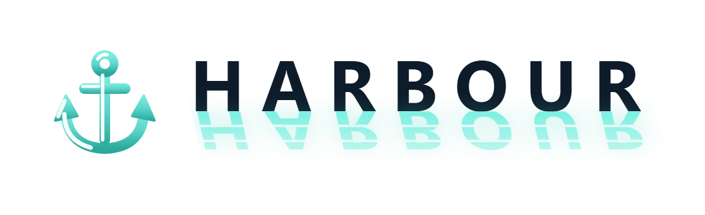
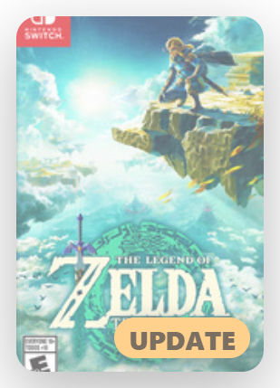

<picture>
  <source media="(prefers-color-scheme: dark)" srcset="ui/assets/brand/harbour-logo-dark.png">
  
</picture>

# Your PC ports, recomps, and emulators all on one shelf. Installed and kept up to date automatically.

## What makes it different

- **Ports and emulators together**, all on one shelf.
- **Automatically shows available ports**, along with their playability score.
- **1,300+ ports** from [Recompendium](https://recompendium.com/)'s catalogue: pick one, choose your game file, done.
- **Emulators set up for you:** install with one click, Harbour auto-applies your settings.
- **One-click updates** for ports and emulators, checked before they're installed.

## Badges

| | |
|---|---|
|  | Emulator up to date |
|  | Emulator has an update |
|  | No emulator yet |
|  | PC port has an update |

## Get it

Windows 10 and 11. Download the zip from [Releases](https://github.com/goodthanksdev/harbour/releases), unzip, run
`Harbour.exe`. If Windows warns you: **More info → Run anyway**.

No games, ROMs or keys included: bring your own.

## Built on

[PyroCade](https://github.com/Pyrodrifter/PyroCade) · [Recompendium](https://recompendium.com/) ·
[LaunchBox Games Database](https://gamesdb.launchbox-app.com/) · [GameTDB](https://www.gametdb.com/) ·
[libretro thumbnails](https://thumbnails.libretro.com/) · [Electron](https://www.electronjs.org/) ·
[yt-dlp](https://github.com/yt-dlp/yt-dlp) · [FFmpeg](https://ffmpeg.org/)

## License

[MIT-0](LICENSE): do what you like. The parts based on PyroCade keep its MIT notice ([notices](THIRD_PARTY_NOTICES.md)).
